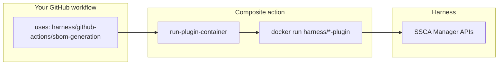

# SSCA GitHub Actions — sample workflows

End-to-end **Harness Software Supply Chain Assurance (SSCA)** examples for GitHub Actions. Every step calls official composites from **[harness/github-actions](https://github.com/harness/github-actions)** (actions live at the **repo root** there—no `v2/` folder).

[](https://developer.harness.io/docs/software-supply-chain-assurance)
[](https://github.com/harness/github-actions)

---

## Table of contents

1. [How it works](#how-it-works)
2. [Plugin images and subcommands](#plugin-images-and-subcommands)
3. [Workflow catalog](#workflow-catalog)
4. [Signing methods](#signing-methods)
5. [Container artifacts](#container-artifacts)
6. [Local (non-container) artifacts](#local-non-container-artifacts)
7. [Repository artifacts](#repository-artifacts)
8. [GitHub configuration](#github-configuration)
9. [Run a workflow](#run-a-workflow)
10. [Related docs](#related-docs)

---

## How it works



1. Your job references a marketplace composite (for example `sbom-generation@SSCA-8414`).
2. The composite delegates to **`run-plugin-container`**, which may fetch a **GitHub OIDC** token when `OIDC_PROVIDER: non-harness`.
3. A pinned **Docker plugin** runs with a fixed **CLI subcommand** (`github-orchestrate`, `github-enforce`, …).
4. Results and metadata are stored in your Harness account (SBOM, provenance, enforcement, signing records).

This repository contains **workflows only**—not copies of the composites.

> **Action ref:** Workflows pin **`harness/github-actions@SSCA-8414`** ([PR #10](https://github.com/harness/github-actions/pull/10)) until the marketplace changes merge to `main`. After release, switch to `@main` or a version tag (for example `@1.2.0`).

---

## Plugin images and subcommands

Each marketplace action maps to **one container image** and **one entrypoint subcommand**. Optional env such as `PLUGIN_MODE` distinguishes generation vs ingestion for SSCA orchestrate.

| Marketplace action | Docker image | Entrypoint | Subcommand | Extra env |
|--------------------|--------------|------------|------------|-----------|
| [`sbom-generation`](https://github.com/harness/github-actions/tree/main/sbom-generation) | `harness/ssca-plugin:0.70.0` | `/bin/ssca-plugin` | **`github-orchestrate`** | `PLUGIN_MODE=generation` |
| [`sbom-ingestion`](https://github.com/harness/github-actions/tree/main/sbom-ingestion) | `harness/ssca-plugin:0.70.0` | `/bin/ssca-plugin` | **`github-orchestrate`** | `PLUGIN_MODE=ingestion` |
| [`sbom-policy-enforcement`](https://github.com/harness/github-actions/tree/main/sbom-policy-enforcement) | `harness/ssca-plugin:0.70.0` | `/bin/ssca-plugin` | **`github-enforce`** | — |
| [`slsa-generation`](https://github.com/harness/github-actions/tree/main/slsa-generation) | `harness/slsa-plugin:0.70.0` | `/bin/slsa-plugin` | **`github-attest`** | `ATTEST_SLSA` when attesting |
| [`slsa-verification`](https://github.com/harness/github-actions/tree/main/slsa-verification) | `harness/slsa-plugin:0.70.0` | `/bin/slsa-plugin` | **`github-verify`** | `VERIFY_SLSA` |
| [`artifact-signing`](https://github.com/harness/github-actions/tree/main/artifact-signing) | `harness/ssca-artifact-signing-plugin:0.70.0` | `/bin/ssca-artifact-signing-plugin` | **`github-sign`** | — |
| [`artifact-verification`](https://github.com/harness/github-actions/tree/main/artifact-verification) | `harness/ssca-artifact-signing-plugin:0.70.0` | `/bin/ssca-artifact-signing-plugin` | **`github-verify`** | — |

### Typical SSCA job sequence (all artifact types)

```text
sbom-generation (github-orchestrate, generation)
    → optional: resolve sbom_*.json on runner
    → sbom-ingestion (github-orchestrate, ingestion)
    → sbom-policy-enforcement (github-enforce)

slsa-generation (github-attest)
    → slsa-verification (github-verify)   [when attest enabled]

artifact-signing (github-sign)
    → artifact-verification (github-verify)
```

Container workflows run **three parallel jobs** (`ssca`, `slsa`, `artifact-signing`). Repository workflows in this repo currently exercise the **SSCA** path only.

---

## Workflow catalog

All workflows use **`workflow_dispatch`**. Keyless flows need **`permissions: id-token: write`**.

| Workflow | File | `SOURCE_TYPE` | Signing | Jobs |
|----------|------|---------------|---------|------|
| Container keyless | [`container-keyless.yml`](.github/workflows/container-keyless.yml) | `docker` | Fulcio / GitHub OIDC | `ssca`, `slsa`, `artifact-signing` |
| Container KMS | [`container-kms.yml`](.github/workflows/container-kms.yml) | `docker` | Vault Transit (`KMS_KEY`) | `ssca`, `slsa`, `artifact-signing` |
| Local keyless | [`non-container-keyless.yml`](.github/workflows/non-container-keyless.yml) | `local` | Keyless | `ssca`, `slsa`, `artifact-signing` |
| Local KMS | [`non-container-kms.yml`](.github/workflows/non-container-kms.yml) | `local` | Vault KMS | `ssca`, `slsa`, `artifact-signing` |
| Repository keyless | [`repo-keyless.yml`](.github/workflows/repo-keyless.yml) | `repository` | Keyless | `ssca` |
| Repository KMS | [`repo-kms.yml`](.github/workflows/repo-kms.yml) | `repository` | Vault KMS | `ssca` |

**Dispatch input:** most workflows expose `attest` (boolean). When `true`, attestation and verification flags are enabled where applicable.

---

## Signing methods

### Comparison

| | **Keyless (Harness Fulcio)** | **Vault KMS (Cosign)** |
|---|------------------------------|-------------------------|
| **Workflows** | `*-keyless.yml` | `*-kms.yml` |
| **Permissions** | `id-token: write` required | Default `contents: read` is enough |
| **Job `env`** | `FULCIO_URL: ${{ vars.FULCIO_QA_URL }}` | — |
| **Action `with:`** | `OIDC_PROVIDER: non-harness` | `KMS_KEY`, `VAULT_ADDR`, `VAULT_TOKEN` |
| **Secrets** | Harness + registry | Harness + Vault + registry |
| **Cosign** | OIDC → Fulcio (`audience=harness-fulcio`) | `hashivault://<KMS_KEY>` |

### Keyless — minimal pattern

```yaml
permissions:
  contents: read
  id-token: write

env:
  FULCIO_URL: ${{ vars.FULCIO_QA_URL }}

steps:
  - uses: harness/github-actions/sbom-generation@SSCA-8414
    with:
      OIDC_PROVIDER: non-harness
      ATTEST_SBOM: true
      SOURCE_TYPE: docker
      SBOM_SOURCE: ${{ vars.DEVSECOPS_TARGET_IMAGE }}
      # ... HARNESS_*, SBOM_TOOL, SBOM_FORMAT
```

### Vault KMS — minimal pattern

```yaml
steps:
  - uses: harness/github-actions/sbom-generation@SSCA-8414
    with:
      ATTEST_SBOM: true
      KMS_KEY: SSCA_AUTOMATION_COSIGN_KEY
      VAULT_ADDR: ${{ secrets.VAULT_ADDR }}
      VAULT_TOKEN: ${{ secrets.VAULT_TOKEN }}
      SOURCE_TYPE: docker
      SBOM_SOURCE: ${{ vars.DEVSECOPS_TARGET_IMAGE }}
      # ... HARNESS_*, SBOM_TOOL, SBOM_FORMAT
```

Do **not** set `OIDC_PROVIDER` when using Vault signing.

---

## Container artifacts

**`SOURCE_TYPE: docker`** — scan/sign a **container image** referenced by `SBOM_SOURCE`, `SLSA_SOURCE`, or `SIGNING_SOURCE`.

### What you configure

| Layer | Keys | Example |
|-------|------|---------|
| Image | `SBOM_SOURCE` / `SLSA_SOURCE` / `SIGNING_SOURCE` | `docker.io/myorg/app:1.0.0` (repo var `DEVSECOPS_TARGET_IMAGE`) |
| Registry auth | `DOCKER_USERNAME`, `DOCKER_PASSWORD` | GitHub Secrets |
| SBOM output | `PLUGIN_SBOMDESTINATION` | Repo var `SBOM_LOCAL_PATH` (must be visible on runner **and** mounted into plugin—prefer under `${{ github.workspace }}`) |
| Harness | `HARNESS_*`, `SBOM_TOOL`, `SBOM_FORMAT` | Repository variables / secrets |

### Example flow ([`container-keyless.yml`](.github/workflows/container-keyless.yml))

```yaml
permissions:
  contents: read
  id-token: write
env:
  FULCIO_URL: ${{ vars.FULCIO_QA_URL }}

jobs:
  ssca:
    runs-on: ubuntu-latest
    steps:
      - uses: actions/checkout@v4
      - uses: docker/login-action@v3
        with:
          username: ${{ secrets.DOCKER_USERNAME }}
          password: ${{ secrets.DOCKER_PASSWORD }}

      - name: SBOM generation
        uses: harness/github-actions/sbom-generation@SSCA-8414
        with:
          HARNESS_ACCOUNT_URL: ${{ vars.HARNESS_QA_ACCOUNT_URL }}
          HARNESS_API_KEY: ${{ secrets.HARNESS_QA_API_KEY }}
          HARNESS_ACCOUNT_ID: ${{ vars.HARNESS_QA_ACCOUNT_ID }}
          HARNESS_ORG_ID: ${{ vars.HARNESS_QA_ORG_ID }}
          HARNESS_PROJECT_ID: ${{ vars.HARNESS_QA_PROJECT_ID }}
          SBOM_TOOL: ${{ vars.SBOM_TOOL }}
          SBOM_FORMAT: ${{ vars.SBOM_FORMAT }}
          SOURCE_TYPE: docker
          SBOM_SOURCE: ${{ vars.DEVSECOPS_TARGET_IMAGE }}
          PLUGIN_SBOMDESTINATION: ${{ vars.SBOM_LOCAL_PATH }}
          ATTEST_SBOM: ${{ inputs.attest }}
          OIDC_PROVIDER: non-harness
          DOCKER_USERNAME: ${{ secrets.DOCKER_USERNAME }}
          DOCKER_PASSWORD: ${{ secrets.DOCKER_PASSWORD }}

      # Resolves latest sbom_*.json for ingestion step
      - name: Resolve SBOM file for ingestion
        env:
          SBOM_LOCAL_PATH: ${{ vars.SBOM_LOCAL_PATH }}
        run: |
          SBOM_FILE="$(ls -t "$SBOM_LOCAL_PATH"/sbom_*.json 2>/dev/null | head -1)"
          test -n "$SBOM_FILE"
          echo "INGESTION_SBOM_FILE=$SBOM_FILE" >> "$GITHUB_ENV"

      - name: SBOM ingestion
        uses: harness/github-actions/sbom-ingestion@SSCA-8414
        with:
          SOURCE_TYPE: docker
          SBOM_SOURCE: ${{ vars.DEVSECOPS_TARGET_IMAGE }}
          PLUGIN_SBOMDESTINATION: ${{ env.INGESTION_SBOM_FILE }}
          ATTEST_SBOM: ${{ inputs.attest }}
          OIDC_PROVIDER: non-harness
          # ... same HARNESS_* and DOCKER_*

      - name: SBOM policy enforcement
        uses: harness/github-actions/sbom-policy-enforcement@SSCA-8414
        with:
          SOURCE_TYPE: docker
          SBOM_SOURCE: ${{ vars.DEVSECOPS_TARGET_IMAGE }}
          VERIFY_SBOM: ${{ inputs.attest }}
          POLICY_SET_REF: ${{ vars.OPA_QA_POLICY_SET_REF }}
          OIDC_PROVIDER: non-harness
          # ... HARNESS_*
```

Parallel jobs **`slsa`** and **`artifact-signing`** mirror the same image with `slsa-generation` / `slsa-verification` and `artifact-signing` / `artifact-verification`. See the full YAML in the workflow file.

**KMS variant:** [`container-kms.yml`](.github/workflows/container-kms.yml) — same structure; replace `OIDC_PROVIDER` with `KMS_KEY` + Vault secrets.

---

## Local (non-container) artifacts

**`SOURCE_TYPE: local`** — SBOM/SLSA/signing for a **file** on the runner (zip, tarball, etc.).

### What you configure

| Input | Purpose |
|-------|---------|
| `SBOM_SOURCE` / `SLSA_SOURCE` / `SIGNING_SOURCE` | Absolute path to the artifact file |
| `ARTIFACT_WORKSPACE` | Same path (plugin non-container identity) |
| `ARTIFACT_NAME` | Logical name (e.g. `scs-sample-app.zip`) |
| `ARTIFACT_VERSION` | Version label (e.g. `v1`) |

Paths must live under **`GITHUB_WORKSPACE`** so the plugin container can read them (workspace is bind-mounted).

### Prepare step in this repo

[`prepare-non-container-artifact`](.github/actions/prepare-non-container-artifact/action.yml) builds `artifacts/scs-sample-app.zip` before SSCA steps run.

### Example snippet ([`non-container-keyless.yml`](.github/workflows/non-container-keyless.yml))

```yaml
env:
  LOCAL_ARTIFACT: ${{ github.workspace }}/artifacts/scs-sample-app.zip
  FULCIO_URL: ${{ vars.FULCIO_QA_URL }}

steps:
  - uses: actions/checkout@v4
  - uses: ./.github/actions/prepare-non-container-artifact

  - uses: harness/github-actions/sbom-generation@SSCA-8414
    with:
      SOURCE_TYPE: local
      SBOM_SOURCE: ${{ env.LOCAL_ARTIFACT }}
      ARTIFACT_WORKSPACE: ${{ env.LOCAL_ARTIFACT }}
      ARTIFACT_NAME: scs-sample-app.zip
      ARTIFACT_VERSION: v1
      PLUGIN_SBOMDESTINATION: ${{ vars.SBOM_LOCAL_PATH }}
      OIDC_PROVIDER: non-harness
      ATTEST_SBOM: ${{ inputs.attest }}
      SBOM_TOOL: ${{ vars.SBOM_TOOL }}
      SBOM_FORMAT: ${{ vars.SBOM_FORMAT }}
      # ... HARNESS_*
```

Ingestion, enforce, SLSA, and signing steps repeat the same `SOURCE_TYPE`, source path, and `ARTIFACT_*` fields. **KMS:** [`non-container-kms.yml`](.github/workflows/non-container-kms.yml).

---

## Repository artifacts

**`SOURCE_TYPE: repository`** — generate/ingest/enforce SBOM from **source code** (Git URL), not from a pre-built image.

### Job `env` (required — not action inputs)

| Variable | Role |
|----------|------|
| `REPO_URL` | Clone URL (e.g. `vars.GIT_REPO_URL`) |
| `REPO_PATH` | Path inside repo to scan (often `/`) |
| `REPO_VARIANT` | Branch or tag name |
| `REPO_VARIANT_TYPE` | `branch` or `tag` |
| `REPO_CLONED_CODEBASE` | Directory on runner where code was checked out |

`run-plugin-container` forwards these into the plugin.

### Example ([`repo-keyless.yml`](.github/workflows/repo-keyless.yml))

```yaml
jobs:
  ssca:
    runs-on: ubuntu-latest
    env:
      FULCIO_URL: ${{ vars.FULCIO_QA_URL }}
      REPO_URL: ${{ vars.GIT_REPO_URL }}
      REPO_PATH: /
      REPO_VARIANT: ${{ vars.GIT_BRANCH }}
      REPO_VARIANT_TYPE: branch
      REPO_CLONED_CODEBASE: ${{ github.workspace }}/sample-repo
    steps:
      - uses: actions/checkout@v4

      - uses: actions/checkout@v4
        with:
          repository: KartikSaurya/Buggy-App
          ref: ${{ vars.GIT_BRANCH }}
          path: sample-repo

      - uses: harness/github-actions/sbom-generation@SSCA-8414
        with:
          SOURCE_TYPE: repository
          SBOM_SOURCE: ${{ vars.GIT_REPO_URL }}
          SBOM_TOOL: ${{ vars.SBOM_TOOL }}
          SBOM_FORMAT: ${{ vars.SBOM_FORMAT }}
          PLUGIN_SBOMDESTINATION: ${{ vars.SBOM_LOCAL_PATH }}
          OIDC_PROVIDER: non-harness
          ATTEST_SBOM: "false"
          # ... HARNESS_*

      # ingestion + sbom-policy-enforcement with SOURCE_TYPE: repository
```

**KMS variant:** [`repo-kms.yml`](.github/workflows/repo-kms.yml) — Vault fields instead of `OIDC_PROVIDER`.

---

## GitHub configuration

Configure **Variables** and **Secrets** on this repository before dispatching workflows.

### Harness (all workflows)

| Name | Type | Used for |
|------|------|----------|
| `HARNESS_QA_ACCOUNT_URL` | Variable | `HARNESS_ACCOUNT_URL` |
| `HARNESS_QA_ACCOUNT_ID` | Variable | Account ID |
| `HARNESS_QA_ORG_ID` | Variable | Org ID |
| `HARNESS_QA_PROJECT_ID` | Variable | Project ID |
| `HARNESS_QA_API_KEY` | Secret | API key |
| `SBOM_TOOL` | Variable | e.g. `Syft` |
| `SBOM_FORMAT` | Variable | e.g. `cyclonedx-json` |
| `SBOM_LOCAL_PATH` | Variable | SBOM output directory on runner |
| `OPA_QA_POLICY_SET_REF` | Variable | Policy set for enforce step |

### Container-specific

| Name | Type |
|------|------|
| `DEVSECOPS_TARGET_IMAGE` | Variable — image to scan |
| `DOCKER_USERNAME` / `DOCKER_PASSWORD` | Secrets |

### Repository-specific

| Name | Type |
|------|------|
| `GIT_REPO_URL` | Variable |
| `GIT_BRANCH` | Variable |

### Keyless

| Name | Type |
|------|------|
| `FULCIO_QA_URL` | Variable — mapped to job `FULCIO_URL` |

### Vault KMS

| Name | Type |
|------|------|
| `VAULT_ADDR` | Secret |
| `VAULT_TOKEN` | Secret |
| `KMS_KEY` | Often in workflow or variable — Transit key name |

---

## Run a workflow

1. Confirm **[harness/github-actions](https://github.com/harness/github-actions/tree/SSCA-8414)** branch **`SSCA-8414`** is available (or update pins after [PR #10](https://github.com/harness/github-actions/pull/10) merges).
2. Set variables and secrets above.
3. In GitHub: **Actions** → choose **container-keyless**, **non-container-kms**, **repo-keyless**, etc.
4. Click **Run workflow** → set **attest** if the workflow supports it → **Run**.

---

## Related docs

- **[harness/github-actions README](https://github.com/harness/github-actions/blob/main/README.md)** — full input reference, registry types (`acr`, `ecr`, …), and signing details.
- **[Harness SSCA documentation](https://developer.harness.io/docs/software-supply-chain-assurance)** — product guides for SBOM, SLSA, and policies.

### Legacy folders at repo root

Directories such as `sbom-generation/` at the **root of this repo** are **legacy V1 composites** and are **not** used by current workflows. Use the marketplace actions only.
